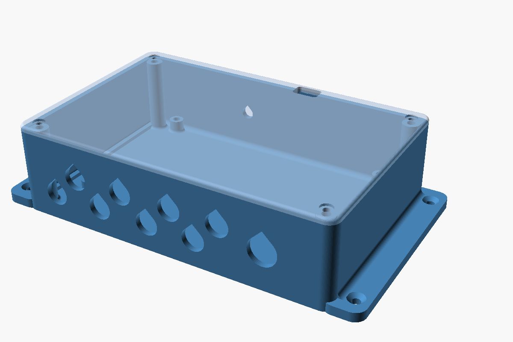

# E8-WiFi Plus wall enclosure

[`e8_wifi_plus_enclosure.scad`](e8_wifi_plus_enclosure.scad) is a parametric, two-piece PETG
enclosure for one Lightish E8-WiFi Plus board. It has a base with board standoffs, cable-gland
holes and wall-mount flanges, and a lid held by four M3 screws into heat-set inserts. Open it
in OpenSCAD, set `part`, press F6 and export the STL.

## Default size

| | |
|---|---|
| Outside, without flanges | 171 × 111 × 47 mm |
| Footprint with flanges | 199 × 111 mm |
| Cavity | 165 × 105 × 41 mm |

## Layout

Positions come from the vendor's *Board Dimensions* photo of a V1.02 board, scaled at about
4.8 px/mm, so they are good to roughly ±1 mm.

- **Front wall:** two staggered M12 glands per output block, right in front of it. The lower
  gland feeds the block's lower (even) output and the upper gland its upper (odd) output.
  The M16 power gland sits in front of X5 at the right.
- **Back wall:** the antenna hole, behind the ESP32's u.FL socket.
- **Lid:** a window over the vertical USB-C at the back edge.
- **Standoffs:** three take heat-set inserts. The front-left hole sits under the corner of
  the X1 block where no screw head fits, so it gets a locating pin instead.
- `outputs_used` drops the holes for outputs a board doesn't drive. Rack 1's second board
  only uses 6.

## Check before printing

Every value tagged `[CHECK]` in the script was read off the photo or assumed. A minute with
calipers is worth it for these:

| Parameter | Default | What to check |
|---|---|---|
| `board_holes` | (2.5, 3.0) (133, 3.3) (2.5, 82.3) (130.5, 82.3) | Hole centres from the front-left corner |
| `board_hole_d` | 3.2 mm | Hole size, which sets the locating pin |
| `block_x`, `power_x` | 10.2 / 36.7 / 64.2 / 89.9, 119.2 mm | Centre of X1–X4 (the D pin) and of X5 |
| `usb_x`, `usb_y` | 87.0, 82.0 mm | USB-C centre |
| `board_comp_h` | 24.4 mm | Tallest part above the PCB (the fuses or the terminals) |

Two things the photo can't settle:

- The back-right screw head (5.5 mm) sits about 1 mm from the X6 terminal block. If it
  doesn't fit, switch that hole to `"pin"` as well.
- The gland rows sit about 3 mm and 15 mm above the PCB (`lower_z`, `upper_z`). Measure how
  high the two wire entries of a block are and move the rows to match, so each cable runs
  straight in.

## Hardware per enclosure

| Item | Qty |
|---|---|
| M3 heat-set insert, 4.0–4.2 mm OD, 4–5 mm long | 7 |
| M3 × 6 screw, board to standoffs | 3 |
| M3 × 8 screw, lid | 4 |
| M12 × 1.5 cable gland (3–6.5 mm cable) | up to 8, one per output in use |
| M16 × 1.5 cable gland | 1, power in |
| 4 mm countersunk wood screw + plug | 4 |

For rack 1's second board (6 strands), set O7 and O8 to `false` in `outputs_used` and print
it with 6 output holes.

## Print settings

PETG, 0.2 mm layers, 4 perimeters, 25–40 % gyroid. Print the base floor-down and the lid
outer-face-down (`part = "print"` lays out both). No supports: the wall holes are teardrops,
and the gland's hex and sealing washer cover the point.
