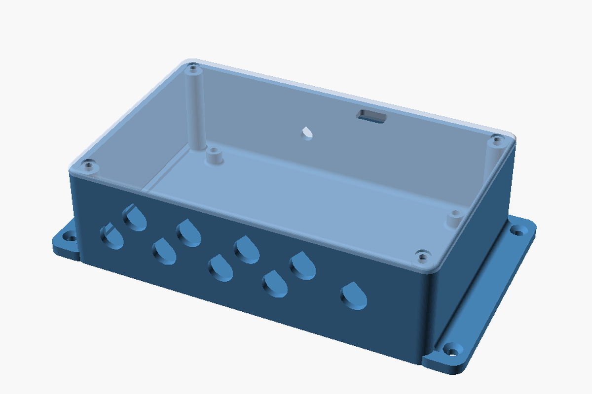

# E8-WiFi Plus wall enclosure

[`e8_wifi_plus_enclosure.scad`](e8_wifi_plus_enclosure.scad) is a parametric, two-piece PETG
enclosure for one Lightish E8-WiFi Plus board. It has a base with board standoffs, cable-gland
holes and wall-mount flanges, and a lid held by four M3 screws into heat-set inserts. Open it
in OpenSCAD, set `part`, press F6 and export the STL.

## Default size

| | |
|---|---|
| Outside, without flanges | 171 × 111 × 50.6 mm |
| Footprint with flanges | 199 × 111 mm |
| Cavity | 165 × 105 × 44.6 mm |

## Layout

Positions come from the vendor's *Board Dimensions* photo of a V1.02 board, scaled at about
4.8 px/mm, so they are good to roughly ±1 mm.

- **Front wall:** two staggered M12 glands per output block, right in front of it. The lower
  gland feeds the block's lower (even) output and the upper gland its upper (odd) output.
  The power gland, also M12, sits in front of X5 at the right.
- **Back wall:** the antenna hole, behind the ESP32's u.FL socket. The board sits 9 mm
  clear of this wall (`back_bay`) so the antenna lead has room to route, and 11 mm from the
  front wall (`front_bay`). Trade one against the other to keep the box the same size.
- **Lid:** a window over the vertical USB-C at the back edge.
- **Standoffs:** four, each with a heat-set insert, on the board's 127 × 77 mm hole rectangle
  (measured on a real board).
- `outputs_used` drops the holes for outputs a board doesn't drive (see board 1B below).

## Check before printing

Every value tagged `[CHECK]` in the script was read off the photo or assumed. A minute with
calipers is worth it for these:

| Parameter | Default | What to check |
|---|---|---|
| `block_x`, `power_x` | 10.2 / 36.7 / 64.2 / 89.9, 119.2 mm | Centre of X1–X4 (the D pin) and of X5 |
| `usb_x`, `usb_y` | 87.0, 82.0 mm | USB-C centre |
| `power_entry_h` | 14 mm | Height of X5's wire entry above the PCB |

Measured on a real board: the X5 block is the tallest part at 28 mm above the PCB, and the
output blocks' wire entries are at 13 mm (lower) and 21 mm (upper). The entries are only 8 mm
apart, which is too close for staggered M12 lock-nuts. The upper row is capped at 22 mm by the
lid lip, so the script drops the lower row until the closest diagonal pair of nuts (12.8 mm
apart in X) clears by `gland_clear` (1.5 mm). With 17.4 mm nuts (M12, AF15) that puts the rows
at 8.1 and 22 mm above the PCB. The lower cables bend about 5 mm on their way up to the
terminal, which the 11 mm front gap takes. If your lock-nuts are bigger, set `gland_nut_ac`
(across corners = 1.155 x across flats) and the rows re-space themselves.

## Hardware per enclosure

| Item | Qty |
|---|---|
| ruthex RX-M3Sx4.0 heat-set insert (4.0 mm hole, 5 mm deep) | 8 |
| M3 × 6 screw, board to standoffs | 4 |
| M3 × 6 screw, lid | 4 |
| M12 × 1.5 cable gland (3–6.5 mm cable) | up to 9: one per output in use, plus 1 for power in |
| 4 mm countersunk wood screw + plug | 4 |

The power gland is the same M12 as the outputs, so it grips a 16 AWG (1.5 mm²) twin power
cable. If that cable is flat rather than round, slide a short piece of heat-shrink over it
where it passes through the gland so the insert can seal around it.

Board 1B (`winerack1bled.yaml`) drives O3–O8 and leaves O1 and O2 empty, so print its box with
`outputs_used = [false, false, true, true, true, true, true, true]`. That leaves out both X1
holes. Keep all 8 holes on board 1A and rack 2, since a strand may move from O1 to O2.

## Print settings

PETG, 0.2 mm layers, 4 perimeters, 25–40 % gyroid. Print the base floor-down and the lid
outer-face-down (`part = "print"` lays out both). No supports: the wall holes are teardrops,
and the gland's hex and sealing washer cover the point.
