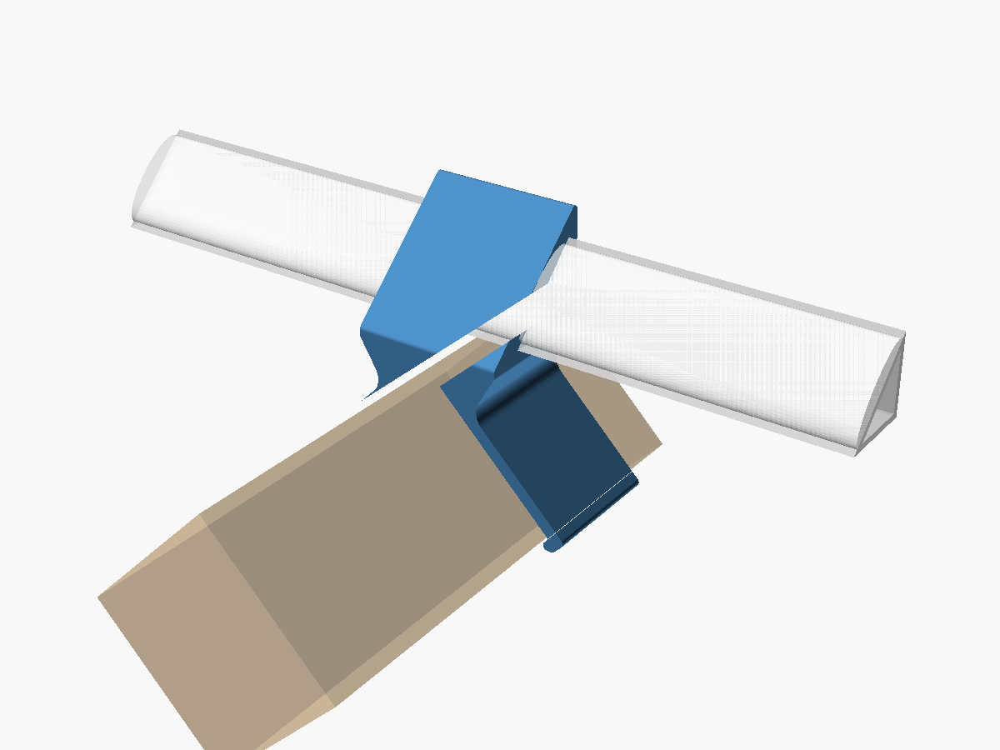
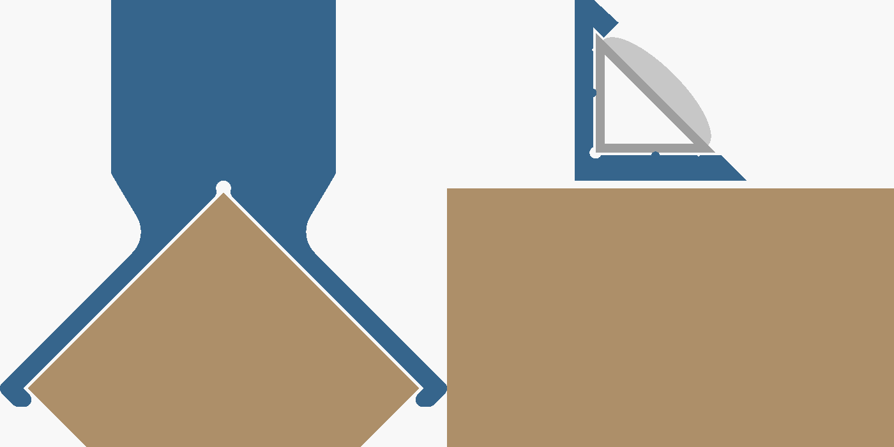

# LED profile clip for the rack dividers

[`led_profile_divider_clip.scad`](led_profile_divider_clip.scad) is a parametric PETG clip that
snaps over a 27 mm square wooden divider set corner-up (45°). It carries a 16 × 16 mm aluminium
corner LED profile **across** the divider, so one long profile bridges every divider in a row
behind the bottles. The profile is tilted so the light shines forwards into the rack. Open it in
OpenSCAD, set `part`, press F6 and export the STL.

Left: looking along the divider. Right: section through the channel, with the rack's front to the
right.

## How it works

- **Saddle:** a 2.5 mm band, 26 mm long, that follows the divider's two upper faces. Its hooks
  reach `grip_depth` (3.5 mm) under the divider's side corners, so the clip clicks on when pushed
  straight down. The divider's upper faces act as the lead-in ramp.
- **Channel:** runs at 90° to the divider. The corner profile lies in it at `beam_angle` (45°),
  with one back flat on the floor and the other against a vertical back wall, so the diffuser faces
  forwards and upwards. There is 0.4 mm sliding clearance on every face. Two lips hook
  `lip_overlap` (0.9 mm) over the profile's edges, one on top of the back wall and one at the
  floor's front edge, so it slides in from the end and a knock from a bottle cannot pop it out.
  Crush ribs are off by default (`crush = 0`) so the profile sits flush.
- **Front lip needs support:** printed on the back face, the front lip starts in mid-air inside
  the channel. Support it there only (see Print notes). `front_lip = false` drops that lip and
  the clip prints with no support, held by the top lip alone.
- **Coordinates:** X is along the profile, Y along the divider (+Y towards the front of the rack),
  Z is up.

## Default size

| | |
|---|---|
| Along the divider | 26 mm |
| Channel length along the profile | 30 mm |
| Width over the hooks | about 60 mm |

## Fitting

1. Print one clip and test it on the wood and on the profile before printing the rest.
2. Push a clip down over the back end of each divider in the row and line them up.
3. Slide the profile through all the clips from one end.

## Tuning

| Parameter | Default | Change it when |
|---|---|---|
| `divider_side` | 27.0 | the real wood measures differently |
| `divider_clear` | 0.25 | the clip is too tight or loose on the wood |
| `grip_depth` | 3.5 | the clip is too hard to push on (lower) or falls off (raise). 0 = no hooks |
| `profile_tol` | 0.4 | the profile slides too stiffly or rattles |
| `crush` | 0 | the profile slips (raise) or won't go in (lower, or 0) |
| `lip_overlap` | 0.9 | the profile won't clip in or the diffuser bulges out under the lips (lower), or it pops out (raise) |
| `beam_angle` | 45 | you want the light aimed differently: 0 = up, 90 = straight forward |
| `channel_len` | 30 | you want more or less support under the profile |

## Print notes (PETG)

`part = "clip"` exports it standing on its back face. The saddle's cross-section then lies in
every layer, so the hooks flex within a layer (their strong direction), the channel's back wall
is on the bed, and at the default 45° beam every overhang is 45° or less except the front lip.
That lip's underside needs support, and nothing else does: in Bambu Studio, paint support under
it, or open the P2S project files in the project's `led-clip/bambu-p2s/` folder, which carry a
support enforcer for exactly that spot. The support stands on the back wall inside the channel
and pulls out along it. Clean the lip's underside before fitting the profile. Use 0.2 mm layers,
6 walls and 30 % gyroid infill.

## Assumptions

The profile is assumed to be a 90° **corner** profile: two flat 16 mm backs at a right angle,
with the diffuser across the open side. If yours is a different shape (for example a
half-round with a flat base), the channel needs a different pocket. Everything else stays.
