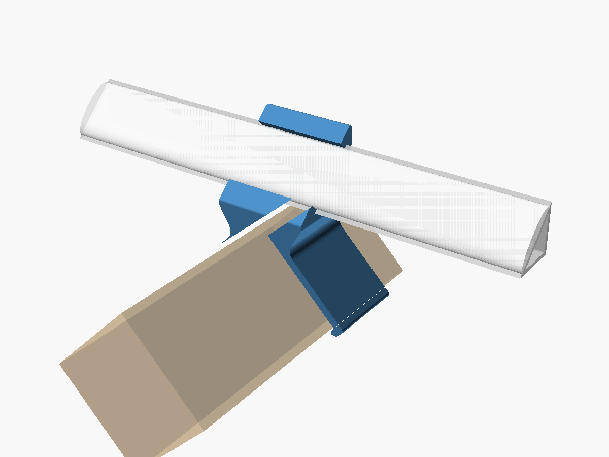
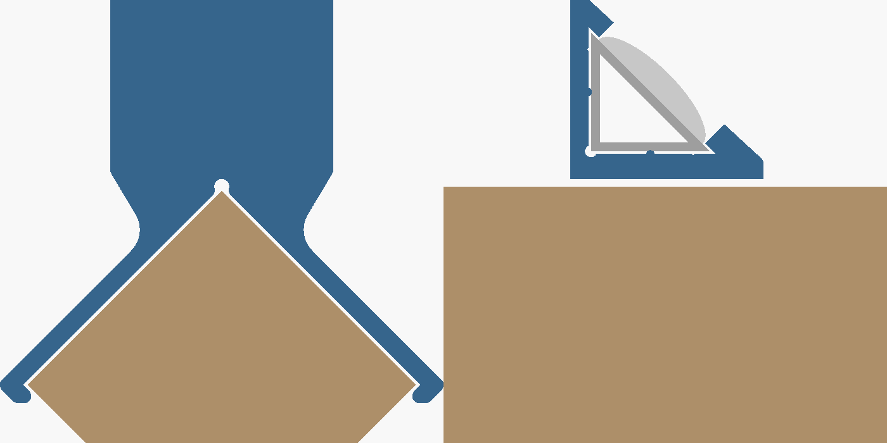

# LED profile clip for the rack dividers

[`led_profile_divider_clip.scad`](led_profile_divider_clip.scad) is a parametric PETG clip that
snaps over a 37 mm square wooden divider set corner-up (45°). It carries a 16 × 16 mm aluminium
corner LED profile **across** the divider, so one long profile bridges every divider in a row
behind the bottles. The profile is tilted so the light shines forwards into the rack. Open it in
OpenSCAD, set `part`, press F6 and export the STL.

Left: looking along the divider. Right: section through the channel, with the rack's front to the
right.

## How it works

- **Saddle:** a 2.5 mm band, 26 mm long, that follows the divider's two upper faces. Its hooks
  reach `grip_depth` (2.5 mm) under the divider's side corners, so the clip clicks on when pushed
  straight down. The divider's upper faces act as the lead-in ramp.
- **Channel:** runs at 90° to the divider. The corner profile lies in it at `beam_angle` (45°),
  with one back flat on the floor and the other against a vertical back wall, so the diffuser faces
  forwards and upwards. There is 0.3 mm sliding clearance on every face. Two lips hook
  `lip_overlap` (1.2 mm) over the profile's front edges, so it slides in from the end and cannot
  lift out. Two crush ribs add a 0.15 mm interference so it stays put.
- **Coordinates:** X is along the profile, Y along the divider (+Y towards the front of the rack),
  Z is up.

## Default size

| | |
|---|---|
| Along the divider | 26 mm |
| Channel length along the profile | 30 mm |
| Width over the hooks | about 60 mm |

## Fitting

1. Print one clip and test it on the wood and on the profile before printing the rest.
2. Push a clip down over the back end of each divider in the row and line them up.
3. Slide the profile through all the clips from one end.

## Tuning

| Parameter | Default | Change it when |
|---|---|---|
| `divider_side` | 37.0 | the real wood measures differently |
| `divider_clear` | 0.4 | the clip is too tight or loose on the wood |
| `grip_depth` | 2.5 | the clip is too hard to push on (lower) or falls off (raise). 0 = no hooks |
| `profile_tol` | 0.3 | the profile slides too stiffly or rattles |
| `crush` | 0.15 | the profile slips (raise) or won't go in (lower, or 0) |
| `lip_overlap` | 1.2 | the diffuser bulges out under the lips (lower) |
| `beam_angle` | 45 | you want the light aimed differently: 0 = up, 90 = straight forward |
| `channel_len` | 30 | you want more or less support under the profile |

## Print notes (PETG)

`part = "clip"` exports it standing on its back face. The saddle's cross-section then lies in
every layer, so the hooks flex within a layer (their strong direction), the channel's back wall
is on the bed, and at the default 45° beam every overhang is 45° or less, so no supports are
needed. Other beam angles may need a little support under the front lip. Use 0.2 mm layers,
4 perimeters and 25–40 % gyroid infill.

## Assumptions

The profile is assumed to be a 90° **corner** profile: two flat 16 mm backs at a right angle,
with the diffuser across the open side. If yours is a different shape (for example a
half-round with a flat base), the channel needs a different pocket. Everything else stays.
